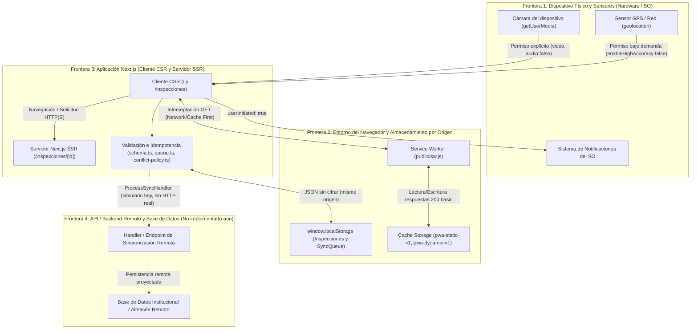

# Modelo de Amenazas y Privacidad Aplicada — PWA Inspecciones de Laboratorio UTT

- **Proyecto:** PWA de Inspecciones de Mantenimiento de Laboratorios (Universidad Tecnológica de Tehuacán — Sujeto Obligado Mexicano)
- **Semana / Actividad:** Semana 09 (`w09-security-privacy`)
- **Responsable del documento:** Felix Ivan Garcia Flores
- **Rama de trabajo:** `feature/semana-09-felix-threat-model`

---

## 1. Propósito, alcance y premisas del análisis

Este documento define el modelo de amenazas de la **PWA Inspecciones de laboratorio UTT** con base en la inspección directa del código fuente, la configuración de compilación, el Service Worker, el almacenamiento local y la suite de pruebas existentes en el repositorio.

### Premisas verificables del estado actual del repositorio
1. **Datos exclusivamente sintéticos:** Todos los registros precargados (`src/lib/data/inspections.ts` y `src/app/inspecciones/[id]/page.tsx`) y los generados en pruebas (`tests/`) son ficticios. El proyecto prohíbe almacenar datos personales reales o credenciales institucionales (`docs/requirements.md`, RNF-03 y RNF-04).
2. **Arquitectura actual sin servidor remoto de negocio ni autenticación:** La aplicación funciona como una PWA en Next.js (`16.4.3`) con rutas CSR (`src/app/inspecciones/page.tsx`) y SSR (`src/app/inspecciones/[id]/page.tsx`), persistencia en `window.localStorage` (`src/lib/storage/inspections.ts` y `src/lib/sync/queue.ts`) y caché offline mediante Service Worker (`public/sw.js`). Como declara explícitamente `src/app/inspecciones/page.tsx` (líneas 48–50), **no existe un backend remoto configurado ni un sistema de autenticación o sesiones activas**.
3. **Distinción estricta de controles:** Ningún control se da por existente si no está implementado en el repositorio. Cada control se clasifica como **Verificado**, **Parcial**, **Pendiente de verificar** o **Propuesto**, enlazando su archivo fuente y prueba ejecutable cuando aplica.

---

## 2. Activos protegidos

Se identifican cuatro categorías principales de activos dentro de la arquitectura actual y proyectada de la PWA:

| ID | Activo | Descripción y función en el sistema | Ubicación / Evidencia en el repositorio | Estado actual de protección |
|---|---|---|---|---|
| **ACT-01** | **Identidad de las personas usuarias** | Atribución de quién registra, consulta o audita una inspección (nombre o identificador del responsable en el campo `inspector`). En un despliegue institucional para un sujeto obligado mexicano, vincula responsabilidades administrativas sobre el mantenimiento de laboratorios. | - Campo `inspector` en `src/lib/data/inspections.ts` (líneas 18, 28, 38) - Campo `inspector` en `src/app/inspecciones/[id]/page.tsx` (líneas 8, 18, 26, 34) - Entrada de formulario `<input name="inspector" required maxLength={120} />` en `src/app/inspecciones/page.tsx` (línea 236) - Regla en `src/lib/storage/schema.ts` (líneas 94–98) | **Parcial (solo validación sintáctica):** Se valida longitud (`<= 120` caracteres) y no vacuidad, pero no existe verificación criptográfica de identidad ni inicio de sesión; cualquier persona con acceso al navegador puede escribir cualquier nombre en `inspector`. |
| **ACT-02** | **Sesión y estado de autenticación** | Contexto temporal que acredita que una persona usuaria autenticada mantiene permisos vigentes en el navegador/dispositivo y permite revocar dicho acceso al cerrar sesión. | - `src/app/layout.tsx` - `src/components/app-shell.tsx` - `src/app/inspecciones/page.tsx` | **No implementado (activo proyectado / vulnerable en estado actual):** No existen cookies de sesión (`HttpOnly`, `Secure`, `SameSite`), cabeceras `Authorization` ni mecanismo de cierre de sesión (`logout`) que limpie el almacenamiento local. |
| **ACT-03** | **Inspecciones y operaciones de sincronización** | Registros de revisión de laboratorios (`Inspection`, `LocalInspection`), hallazgos (`findings`), estado (`ok` / `attention`), resumen (`summary`), metadatos de versionado (`version`, `updatedAt`, `idempotencyKey`) y cola de operaciones pendientes o fallidas (`SyncOperation`). | - `src/lib/data/inspections.ts` - `src/lib/data/create-inspection.ts` - `src/lib/storage/schema.ts` - `src/lib/sync/queue.ts` - `src/lib/sync/conflict-policy.ts` | **Verificado en integridad estructural local / Parcial en confidencialidad:** Cuenta con validación de esquema (`validateLocalInspection`), idempotencia (`idempotencyKey`), límite de reintentos (`maxRetries = 3`) y resolución determinista de conflictos (`resolveInspectionConflict`), pero carece de firma o cifrado local. |
| **ACT-04** | **Datos almacenados en el dispositivo/navegador y capacidades de hardware** | Persistencia en `window.localStorage`, respuestas HTTP almacenadas en `Cache Storage` por el Service Worker (`pwa-static-v1`, `pwa-dynamic-v1`) y datos transitorios provenientes de cámara (`dataUrl` JPEG), geolocalización (`Coordinates`) y notificaciones locales. | - Clave `pwa-inspecciones-local-inspections` en `src/lib/storage/inspections.ts` (línea 6) - Clave `pwa-inspecciones-sync-queue` en `src/lib/sync/queue.ts` (línea 5) - Cachés `pwa-static-v1` y `pwa-dynamic-v1` en `public/sw.js` (líneas 1–2) - `src/lib/device/camera.ts`, `src/lib/device/geolocation.ts`, `src/lib/notifications/client.ts` | **Parcial:** Las capacidades de hardware aplican mínimo privilegio y liberan recursos (`track.stop()`, `enableHighAccuracy: false`, `userInitiated: true`), y el Service Worker solo intercepta `GET` con respuestas válidas (`status === 200`, `type === 'basic'`). Sin embargo, `localStorage` y `Cache Storage` guardan datos en texto plano accesibles para cualquier script del mismo origen o persona con acceso físico al perfil del navegador. |

---

## 3. Actores y perfiles de riesgo

De acuerdo con el dominio operativo de los laboratorios de la UTT (`docs/requirements.md`, sección 2) y el análisis de seguridad, interactúan cuatro perfiles de actores:

| ID | Actor | Rol operativo legítimo | Capacidades y nivel de privilegio esperado | Escenarios de riesgo / abuso |
|---|---|---|---|---|
| **ATR-01** | **Inspector (Persona encargada de la inspección)** | Recorre el laboratorio (con o sin conectividad), registra inspecciones en `/inspecciones`, reporta hallazgos y opcionalmente captura evidencia fotográfica o ubicación. | **Mínimo privilegio operativo:** Crear inspecciones propias, consultar el listado de su área y encolar operaciones locales para sincronización. No debería poder alterar inspecciones cerradas por terceros ni modificar políticas del sistema. | - Captura accidental de información personal o sensible en el campo libre `summary` o mediante fotografías de cámara. - Abandono de sesión o pestaña abierta en una computadora o tableta compartida del laboratorio. - Suplantación del nombre de otro inspector en el campo libre `inspector` (`src/app/inspecciones/page.tsx`, línea 236). |
| **ATR-02** | **Supervisor (Persona responsable del seguimiento)** | Consulta el historial de inspecciones (`/inspecciones` y `/inspecciones/[id]`), filtra laboratorios que requieren atención (`status === 'attention'`) y da seguimiento a los hallazgos. | **Privilegio de lectura y seguimiento:** Consultar registros e historial de hallazgos y actualizar estados de seguimiento, sin alterar unilateralmente la bitácora original ni administrar la infraestructura. | - Acceso a registros fuera de su división académica si no existe control de acceso basado en roles o adscripción. - Resolución o descarte indebido de versiones en conflicto si no existe auditoría de cambios en servidor. |
| **ATR-03** | **Administrador (Gestión técnica / institucional)** | Administra la configuración del despliegue de la PWA, el repositorio, los flujos de integración continua (`.github/workflows/`) y la futura integración con servicios institucionales. | **Privilegio administrativo acotado:** Configurar cabeceras de seguridad, variables de entorno y despliegues sin insertar credenciales en el código fuente ni acceder a datos personales no autorizados. | - Inclusión accidental de credenciales, llaves privadas o rutas internas en el repositorio o en artefactos de CI. - Despliegue sin HTTPS o sin política de seguridad de contenido (CSP), exponiendo a todos los clientes. |
| **ATR-04** | **Terceros (Usuarios no autorizados, atacantes en red, scripts de terceros o rastreadores)** | Ningún rol operativo legítimo dentro del proceso de inspección. Incluye usuarios subsecuentes en un equipo compartido de laboratorio, atacantes en redes Wi-Fi públicas/universitarias, extensiones del navegador o dependencias comprometidas. | **Cero privilegios (No confiable):** No deben leer ni modificar inspecciones locales, ni ejecutar código arbitrario en el origen de la PWA, ni invocar cámara/geolocalización sin consentimiento. | - Lectura o adulteración directa de `localStorage` (`pwa-inspecciones-local-inspections`, `pwa-inspecciones-sync-queue`) y `Cache Storage` en equipos compartidos. - Ejecución de scripts en el cliente (XSS) para extraer el almacenamiento local o invocar capacidades del dispositivo. - Intercepción o manipulación de tráfico en tránsito (MitM) si se accede por HTTP plano. |

---

## 4. Fronteras de confianza

El sistema atraviesa cuatro fronteras de confianza entre el hardware del dispositivo, el entorno del navegador, la aplicación Next.js y los servicios de backend/almacenamiento:

### Descripción detallada de cada frontera

1. **Frontera 1 — Dispositivo físico / Sistema Operativo ↔ Navegador:**
   - **Qué cruza la frontera:** Flujo de video de cámara (`src/lib/device/camera.ts`), coordenadas de ubicación (`src/lib/device/geolocation.ts`), avisos del sistema (`src/lib/notifications/client.ts`) y acceso físico al perfil del navegador en laboratorios.
   - **Supuesto de confianza:** El navegador media el acceso mediante permisos del usuario, pero si el dispositivo físico es compartido entre varios inspectores o alumnos sin bloqueo de sesión del sistema operativo, cualquier persona con acceso a la ventana puede abrir DevTools y leer el origen completo.
2. **Frontera 2 — Almacenamiento local y Service Worker (`localStorage` / `Cache Storage`) ↔ Aplicación Cliente:**
   - **Qué cruza la frontera:** Lectura y escritura de `pwa-inspecciones-local-inspections` (`src/lib/storage/inspections.ts`) y `pwa-inspecciones-sync-queue` (`src/lib/sync/queue.ts`), así como documentos HTML y recursos estáticos interceptados por `public/sw.js`.
   - **Supuesto de confianza:** Todo dato en `localStorage` puede haber sido modificado manualmente desde la consola del navegador o corrompido antes de ser leído por la aplicación. Por ello, `readLocalInspections()` y `loadUserInspections()` revalidan los registros con `validateLocalInspection()` al leerlos (`src/lib/storage/inspections.ts`, líneas 36–44).
3. **Frontera 3 — Cliente en Navegador (CSR) ↔ Servidor de Aplicación Next.js (SSR):**
   - **Qué cruza la frontera:** Solicitudes de documentos HTML, activos estáticos y parámetros de ruta dinámica como `params.id` en `src/app/inspecciones/[id]/page.tsx`.
   - **Supuesto de confianza:** El cliente es un entorno no confiable. Los parámetros de URL (`[id]`), cabeceras y entradas de formularios pueden ser manipulados arbitrariamente. Actualmente, `/inspecciones/[id]/page.tsx` busca `id` en un diccionario estático `mockDatabase` y ejecuta `notFound()` si no existe (líneas 44–55), pero no existen cabeceras HTTP de endurecimiento (CSP, `X-Frame-Options`, `Permissions-Policy`) en `next.config.mjs`.
4. **Frontera 4 — Aplicación / Cola de Sincronización ↔ API/Backend y Base de Datos o Servicios Externos:**
   - **Qué cruza la frontera:** Operaciones `SyncOperation` procesadas mediante `ProcessSyncHandler` en `src/lib/sync/queue.ts` (línea 3) e integradas con `subscribeToConnectivity` en `src/lib/sync/connectivity.ts`.
   - **Supuesto de confianza y estado real:** En el repositorio actual **no existe API/backend ni base de datos remota** (`src/app/inspecciones/page.tsx`, líneas 87–95 passes `undefined` como handler remoto). Cuando esta frontera se conecte a un servicio real, el backend no deberá confiar en el campo `inspector`, ni en `version`, ni en `updatedAt` enviados por el cliente sin validar identidad, permisos por rol e idempotencia del lado del servidor.

---

## 5. Evaluación de amenazas concretas

A continuación se documentan ocho amenazas concretas evaluadas sobre la arquitectura real del repositorio. Para cada una se especifica impacto, probabilidad, controles existentes (con rutas de evidencia), controles propuestos, riesgo residual y pruebas sugeridas.

### T-01: Acceso sin autenticación y suplantación de identidad del inspector
- **Activo afectado:** `ACT-01` (Identidad), `ACT-02` (Sesión), `ACT-03` (Inspecciones).
- **Actor de riesgo:** `ATR-04` (Tercero no autorizado) o `ATR-01` (Inspector que ingresa el nombre de otra persona).
- **Frontera de confianza:** Frontera 3 (Cliente ↔ Aplicación) y Frontera 4 (Aplicación ↔ API/Backend).
- **Descripción técnica:** Las rutas `/`, `/inspecciones` y `/inspecciones/[id]` carecen de verificación de identidad. Además, en el formulario de captura (`src/app/inspecciones/page.tsx`, línea 236), el campo `inspector` es un `<input name="inspector">` de texto libre; cualquier usuario puede registrar una inspección atribuyéndola a otro responsable.
- **Impacto:** **Alto** (pérdida de trazabilidad y repudiación de inspecciones registradas).
- **Probabilidad:** **Alta** (en el estado actual no se requiere ninguna credencial para acceder ni para elegir el nombre del responsable).
- **Controles existentes en el repositorio:**
  - Validación de presencia y longitud máxima (`120` caracteres) del campo `inspector` en `src/lib/storage/schema.ts` (líneas 94–98) y atributo `maxLength={120}` en `src/app/inspecciones/page.tsx` (línea 236) — *Control parcial (solo formato, no autentica identidad)*.
  - Restricción de uso exclusivo de datos sintéticos en el entorno académico (`docs/requirements.md`, RNF-03 y RNF-04) — *Control administrativo/documental*.
- **Controles propuestos:**
  - Implementar autenticación institucional antes de permitir el acceso a `/inspecciones` y `/inspecciones/[id]`.
  - Poblar el campo `inspector` en el servidor a partir de la identidad autenticada de la sesión, eliminando la edición manual libre del responsable.
- **Riesgo residual:** **Medio-Alto** mientras la aplicación opere como demostrador local sin backend de autenticación; **Bajo** una vez integrado el control de sesión en servidor.
- **Pruebas sugeridas:**
  - *Propuesta:* Prueba E2E/integración que intente acceder a `/inspecciones` o enviar `CREATE_INSPECTION` sin sesión activa y verifique redirección o rechazo HTTP `401 Unauthorized`.
  - *Ejecutada (parcial sobre formato):* Prueba unitaria en `tests/unit/validation.spec.ts` que verifica el rechazo cuando `inspector` está vacío o supera 120 caracteres.

---

### T-02: Ausencia de control de acceso por roles (permisos insuficientes entre Inspector, Supervisor y Administrador)
- **Activo afectado:** `ACT-01` (Identidad), `ACT-03` (Inspecciones y cola de sincronización).
- **Actor de riesgo:** `ATR-01` (Inspector), `ATR-02` (Supervisor), `ATR-04` (Tercero).
- **Frontera de confianza:** Frontera 3 (Cliente ↔ Aplicación) y Frontera 4 (Aplicación ↔ API/Backend).
- **Descripción técnica:** El repositorio no distingue permisos entre un inspector (que solo debería registrar y consultar sus inspecciones), un supervisor (que debería revisar y dar seguimiento a hallazgos) y un administrador. Todas las acciones expuestas en la interfaz (`createLocalInspection`, `clearQueue`, consulta de cualquier ID en `/inspecciones/[id]`) están disponibles para cualquier actor.
- **Impacto:** **Alto** (modificación o creación no autorizada de registros y falta de segregación de funciones).
- **Probabilidad:** **Media** (requiere acceso a la aplicación, pero no existe ninguna barrera de autorización por rol).
- **Controles existentes en el repositorio:**
  - En la ruta SSR `src/app/inspecciones/[id]/page.tsx` (líneas 44–55), solo se exponen identificadores predefinidos en `mockDatabase` (`INS-001` a `INS-003`) y cualquier otro identificador invoca `notFound()`, evitando enumeración de archivos arbitrarios del sistema.
  - En `src/lib/storage/inspections.ts` (líneas 54–58), `saveLocalInspection` impide sobrescribir silenciosamente una inspección local existente si el contenido difiere (`Ya existe una inspección local con el identificador ...`).
- **Controles propuestos:**
  - Definir una matriz de control de acceso basado en roles (RBAC) verificada en servidor para las operaciones `CREATE_INSPECTION`, `UPDATE_INSPECTION` y `DELETE_INSPECTION` declaradas en `src/lib/storage/schema.ts` (línea 14).
  - Restringir en rutas SSR y endpoints de API el alcance de consulta según el laboratorio o división asignada al rol.
- **Riesgo residual:** **Medio** en el prototipo local actual (acotado por el uso de datos sintéticos y ausencia de acciones de borrado en UI); **Bajo** tras aplicar RBAC en el backend.
- **Pruebas sugeridas:**
  - *Propuesta:* Prueba de autorización que simule un actor con rol `inspector` intentando ejecutar `DELETE_INSPECTION` o aprobar el cierre de un hallazgo de supervisor, esperando HTTP `403 Forbidden`.
  - *Ejecutada (parcial sobre integridad de no sobrescritura y ruta inexistente):* `tests/rendering.spec.ts` (verifica el manejo de `notFound()` en SSR) y `tests/integration/inspections.spec.ts` (verifica persistencia e integridad al guardar inspecciones locales).

---

### T-03: Persistencia de datos en `localStorage` y `Cache Storage` por falta de cierre de sesión en dispositivos compartidos
- **Activo afectado:** `ACT-02` (Sesión), `ACT-03` (Inspecciones), `ACT-04` (Datos almacenados en el navegador).
- **Actor de riesgo:** `ATR-04` (Usuario subsecuente en tableta o PC compartida del laboratorio).
- **Frontera de confianza:** Frontera 1 (Dispositivo físico ↔ Navegador) y Frontera 2 (`localStorage` / `Cache Storage` ↔ Aplicación).
- **Descripción técnica:** Los laboratorios universitarios suelen emplear equipos de cómputo compartidos. La PWA almacena las inspecciones creadas en `window.localStorage` bajo `pwa-inspecciones-local-inspections` (`src/lib/storage/inspections.ts`, línea 6), la cola de operaciones en `pwa-inspecciones-sync-queue` (`src/lib/sync/queue.ts`, línea 5) y las páginas visitadas en `pwa-dynamic-v1` (`public/sw.js`, línea 2). Aunque `SyncQueue.clear()` existe en `src/lib/sync/queue.ts` (líneas 250–260), **no existe en la interfaz un botón o flujo de cierre de sesión (`logout`)** que limpie `localStorage` ni las cachés dinámicas del Service Worker al finalizar un turno.
- **Impacto:** **Medio-Alto** (exposición de las inspecciones y hallazgos capturados por el turno anterior y posibilidad de que el siguiente usuario altere operaciones pendientes en la cola).
- **Probabilidad:** **Alta** en entornos de laboratorio con equipos de uso común.
- **Controles existentes en el repositorio:**
  - Método `clear()` implementado en `SyncQueue` (`src/lib/sync/queue.ts`, líneas 250–260) que vacía las operaciones en memoria y sincroniza el vaciado en `localStorage`.
  - Limpieza automática de cachés obsoletas durante el evento `activate` del Service Worker (`public/sw.js`, líneas 25–47).
  - Política de no almacenar datos personales reales ni credenciales en el proyecto (`docs/requirements.md`, RNF-03 y RNF-04).
- **Controles propuestos:**
  - Implementar una acción explícita de «Cerrar sesión / Limpiar datos locales del turno» en la interfaz que invoque `syncQueue.clear()`, elimine la clave `pwa-inspecciones-local-inspections` de `localStorage` (advirtiendo si existen operaciones `pending` sin sincronizar) y purgue la caché dinámica `pwa-dynamic-v1`.
  - Configurar caducidad por inactividad para sesiones autenticadas futuras.
- **Riesgo residual:** **Medio** (mitigado actualmente porque solo se procesan datos sintéticos, pero los registros locales persisten indefinidamente hasta limpiar el navegador).
- **Pruebas sugeridas:**
  - *Propuesta:* Prueba de seguridad E2E/integración de cierre de sesión que registre una inspección local, ejecute la acción de cierre de sesión y compruebe que `localStorage.getItem('pwa-inspecciones-local-inspections')`, `localStorage.getItem('pwa-inspecciones-sync-queue')` y `caches.open('pwa-dynamic-v1')` queden vacíos.
  - *Ejecutada (parcial sobre limpieza de cola):* `tests/queue.spec.ts` verifica el método `clear()` de `SyncQueue`.

---

### T-04: Exposición o envenenamiento de respuestas en `Cache Storage` del Service Worker
- **Activo afectado:** `ACT-04` (Datos almacenados en `Cache Storage`), `ACT-03` (Inspecciones visualizadas).
- **Actor de riesgo:** `ATR-04` (Atacante en red local o usuario en el mismo dispositivo).
- **Frontera de confianza:** Frontera 2 (Service Worker / `Cache Storage` ↔ Aplicación Cliente) y Frontera 3 (Cliente ↔ Servidor).
- **Descripción técnica:** El Service Worker (`public/sw.js`) intercepta peticiones `GET` y almacena documentos HTML en `pwa-dynamic-v1` bajo estrategia `Network First` (líneas 60–84) y recursos estáticos bajo `Cache First` (líneas 89–130). Si se almacenaran respuestas de error, respuestas opacas de terceros o páginas con información privada de un usuario, podrían servirse offline a otro usuario o corromper el App Shell. Además, si el Service Worker pudiera registrarse en un origen HTTP inseguro, un atacante en la red podría inyectar un script malicioso persistente.
- **Impacto:** **Alto** (persistencia de contenido malicioso o exposición offline de páginas previamente visitadas).
- **Probabilidad:** **Baja-Media** (reducida por las guardas actuales en el registro y en `public/sw.js`).
- **Controles existentes en el repositorio:**
  - Restricción de registro del Service Worker únicamente a contextos seguros (`protocol === "https:" || hostname === "localhost" || hostname === "127.0.0.1"`) en `src/lib/pwa/register-service-worker.ts` (líneas 19–33) — **Verificado** con `tests/register-service-worker.spec.ts`.
  - Intercepción exclusiva de peticiones `GET` (`if (request.method !== 'GET') return;`) en `public/sw.js` (líneas 53–55) — **Verificado** con `tests/service-worker.spec.ts`.
  - Validación en `Cache First` de que la respuesta sea exitosa y del mismo origen antes de almacenarla en caché dinámica (`!response || response.status !== 200 || response.type !== 'basic'`) en `public/sw.js` (líneas 98–104) — **Verificado** con `tests/offline.spec.ts`.
  - Eliminación de cachés de versiones anteriores en el evento `activate` (`public/sw.js`, líneas 25–42) — **Verificado** con `tests/service-worker.spec.ts`.
- **Controles propuestos:**
  - En la rama `Network First` de `public/sw.js` (líneas 65–75), aplicar la misma guarda `response.ok && response.type === 'basic'` antes de ejecutar `cache.put(request, responseToCache)` para evitar guardar páginas de error `404`/`500` en `pwa-dynamic-v1`.
  - Respetar cabeceras `Cache-Control: no-store, private` para rutas que en el futuro muestren información sensible dependiente de sesión.
- **Riesgo residual:** **Bajo** para recursos estáticos y peticiones no-GET; **Medio-Bajo** para documentos de navegación HTML en `Network First`.
- **Pruebas sugeridas:**
  - *Ejecutadas:* `tests/register-service-worker.spec.ts` (bloqueo en contexto inseguro HTTP), `tests/service-worker.spec.ts` (ignorar métodos distintos de `GET` y limpiar cachés antiguas) y `tests/offline.spec.ts` (no cachear respuestas inválidas y devolver fallback HTTP `503`).
  - *Propuesta:* Prueba unitaria/integración que verifique que una respuesta de navegación HTML con estado `500` o con cabecera `Cache-Control: no-store` no sea persistida en `pwa-dynamic-v1`.

---

### T-05: Inyección de payloads corruptos, manipulación de `localStorage` y denegación de servicio en la cola de sincronización
- **Activo afectado:** `ACT-03` (Inspecciones y cola de sincronización), `ACT-04` (Almacenamiento local).
- **Actor de riesgo:** `ATR-04` (Script o usuario malintencionado en cliente) o `ATR-01` (Entrada anómala en formulario).
- **Frontera de confianza:** Frontera 2 (`localStorage` ↔ Aplicación) y Frontera 3 (Formulario CSR ↔ Lógica de dominio).
- **Descripción técnica:** Un actor con acceso al cliente podría intentar: (a) introducir cadenas excesivamente largas, fechas inválidas, números negativos o `NaN` en el formulario de `/inspecciones`; (b) adulterar directamente el JSON guardado en `localStorage` para inyectar objetos malformados; (c) provocar envíos repetidos rápidos (doble clic) o ciclos infinitos de reintentos que bloqueen la cola de sincronización; o (d) sobrescribir una inspección más reciente con una operación retrasada.
- **Impacto:** **Medio** (bloqueo de la aplicación en el cliente, corrupción de la cola local o pérdida de actualizaciones recientes).
- **Probabilidad:** **Baja** (gracias a las validaciones, bloqueos de concurrencia y límites implementados en el repositorio).
- **Controles existentes en el repositorio:**
  - Validación estricta de dominio mediante `validateLocalInspection` en `src/lib/storage/schema.ts` (líneas 65–154): exige objeto no nulo, `id`, `location` (`<= 120` caracteres), fecha ISO real (`isValidISODate` que descarta fechas inexistentes como `2026-02-30`), `inspector` (`<= 120` caracteres), `status` (`'ok' | 'attention'`), `findings` entero no negativo, `summary` (`<= 500` caracteres) y `version >= 1` finita — **Verificado** con `tests/unit/validation.spec.ts`.
  - Revalidación al leer desde `localStorage` en `readLocalInspections()` (`src/lib/storage/inspections.ts`, líneas 20–44) y en `loadUserInspections()` (`src/lib/data/create-inspection.ts`, líneas 74–81), lanzando errores controlados si el JSON fue corrompido o no cumple el esquema — **Verificado** con `tests/integration/inspections.spec.ts`.
  - Idempotencia por `id` e `idempotencyKey`, bloqueo de procesamiento concurrente (`if (this.processing) return this.processing`) y límite de reintentos (`maxRetries ?? 3`) con separación de agotados (`getExhausted()`) en `src/lib/sync/queue.ts` (líneas 86–146 y 181–195) — **Verificado** con `tests/unit/idempotency.spec.ts` y `tests/integration/queue.spec.ts`.
  - Bloqueo de doble envío en interfaz mediante `submitLock` (`useRef(false)`) y estado `isSaving` en `src/app/inspecciones/page.tsx` (líneas 57–58, 120–122) — **Verificado**.
  - Resolución determinista de conflictos sin mutar objetos de entrada (`resolveInspectionConflict` y `validateCandidate`) en `src/lib/sync/conflict-policy.ts` (líneas 42–181) — **Verificado** con `tests/sync.spec.ts`.
  - Escapado automático de JSX en React (`src/app/inspecciones/page.tsx`, líneas 337–346 y `src/app/inspecciones/[id]/page.tsx`, líneas 68–92), sin uso de `dangerouslySetInnerHTML`.
- **Controles propuestos:**
  - Añadir un límite máximo de operaciones totales almacenables en `SyncQueue` (cuota máxima de cola) y sanitización de caracteres de control antes de persistir.
  - Revalidar el esquema completo en el servidor cuando se implemente el endpoint remoto de sincronización.
- **Riesgo residual:** **Bajo** en el cliente actual.
- **Pruebas sugeridas:**
  - *Ejecutadas:* `tests/unit/validation.spec.ts`, `tests/unit/idempotency.spec.ts`, `tests/sync.spec.ts`, `tests/integration/queue.spec.ts` y `tests/integration/inspections.spec.ts`.

---

### T-06: Abuso de permisos de hardware del dispositivo (cámara, geolocalización y notificaciones)
- **Activo afectado:** `ACT-04` (Privacidad física, cámara, ubicación y notificaciones del dispositivo).
- **Actor de riesgo:** `ATR-04` (Scripts en el origen) o diseño intrusivo de la aplicación.
- **Frontera de confianza:** Frontera 1 (Dispositivo/Sensores ↔ Navegador).
- **Descripción técnica:** Las PWAs con acceso a `navigator.mediaDevices.getUserMedia`, `navigator.geolocation` y `Notification` pueden comprometer la privacidad del inspector si solicitan permisos al cargar la página sin acción del usuario, si capturan audio innecesario, si mantienen la cámara encendida tras tomar la captura, si exigen precisión GPS milimétrica injustificada o si bloquean el trabajo cuando el usuario rechaza el permiso.
- **Impacto:** **Medio-Alto** (exposición de ubicación física, captura de audio/video no deseada o bloqueo operativo en campo).
- **Probabilidad:** **Baja** (los módulos implementados en el repositorio ya aplican controles de mínimo privilegio y degradación elegante).
- **Controles existentes en el repositorio:**
  - **Notificaciones bajo acción explícita:** `requestNotificationPermission` en `src/lib/notifications/client.ts` (líneas 73–87) exige `options.userInitiated === true`; si es `false`, bloquea la llamada a `Notification.requestPermission()` y devuelve fallback con razón `requires-user-action` — **Verificado** con `tests/capabilities.spec.ts`.
  - **Cámara con permisos mínimos y liberación inmediata:** `captureCameraEvidence` en `src/lib/device/camera.ts` (líneas 57–60 y 98–100) solicita únicamente video sin audio (`video: { facingMode }, audio: false`) y detiene todos los tracks en un bloque `finally` (`stream?.getTracks().forEach((track) => track.stop())`), incluso si ocurre un error — **Verificado** con `tests/device-capabilities.spec.ts`.
  - **Geolocalización de precisión mínima predeterminada:** `getCurrentLocation` en `src/lib/device/geolocation.ts` (líneas 67–71) configura por defecto `enableHighAccuracy: false`, `timeout: 10000` y `maximumAge: 60000`, y en caso de denegación o fallo devuelve coordenadas sintéticas de referencia (`DEFAULT_FALLBACK_COORDINATES`) con `isFallback: true` — **Verificado** con `tests/device-capabilities.spec.ts`.
- **Controles propuestos:**
  - Declarar la cabecera HTTP `Permissions-Policy` en `next.config.mjs` para restringir el uso de cámara y geolocalización exclusivamente al propio origen (`self`) y deshabilitar micrófono (`microphone=()`).
  - Eliminar metadatos EXIF en caso de incorporar carga de archivos de imagen desde galería.
- **Riesgo residual:** **Bajo**.
- **Pruebas sugeridas:**
  - *Ejecutadas:* `tests/capabilities.spec.ts` y `tests/device-capabilities.spec.ts` (verifican rechazo sin acción del usuario, denegación de permisos, ausencia de API, liberación de tracks de cámara y precisión mínima en geolocalización).

---

### T-07: Ausencia de cabeceras HTTP de endurecimiento (CSP, Clickjacking, MIME Sniffing) e indexación no controlada
- **Activo afectado:** `ACT-02` (Sesión futura), `ACT-03` (Inspecciones), `ACT-04` (Almacenamiento local en navegador).
- **Actor de riesgo:** `ATR-04` (Atacante externo mediante sitios maliciosos, inyección de recursos o motores de búsqueda).
- **Frontera de confianza:** Frontera 3 (Cliente ↔ Servidor Next.js).
- **Descripción técnica:** Al inspeccionar `next.config.mjs` (líneas 1–7), la configuración actual solo define `reactStrictMode: true` y `allowedDevOrigins: ["127.0.0.1"]`. No se configuran aún cabeceras `Content-Security-Policy` (CSP), `X-Frame-Options` / `frame-ancestors`, `X-Content-Type-Options: nosniff`, `Referrer-Policy` ni `Permissions-Policy`. Asimismo, aún no se encuentra integrado `public/robots.txt` en esta rama individual para indicar a buscadores qué rutas no deben indexarse.
- **Impacto:** **Medio-Alto** (si ocurriera una inyección de contenido o embebido en un `<iframe>` externo, la ausencia de CSP y `frame-ancestors` facilitaría la ejecución de scripts o ataques de clickjacking).
- **Probabilidad:** **Media**.
- **Controles existentes en el repositorio:**
  - `reactStrictMode: true` y restricción `allowedDevOrigins: ["127.0.0.1"]` en `next.config.mjs` (líneas 3–4).
  - Renderizado declarativo en React sin uso de `eval()`, `new Function()` ni `dangerouslySetInnerHTML` en ningún componente de `src/`.
- **Controles propuestos (asignados a los entregables de endurecimiento de la Semana 09):**
  - Configurar cabeceras de seguridad y `Content-Security-Policy` (`default-src 'self'`, `frame-ancestors 'none'`, `object-src 'none'`, `base-uri 'self'`) junto con los módulos en `src/lib/security/`.
  - Incorporar `public/robots.txt` para desautorizar la indexación de rutas operativas o de detalle (`/inspecciones`).
- **Riesgo residual:** **Medio** en esta rama individual documental; **Bajo** tras integrar los entregables del equipo en `src/lib/security/` y `public/robots.txt`.
- **Pruebas sugeridas:**
  - *Propuesta:* Prueba automatizada en `tests/security.spec.ts` que verifique la presencia y directivas mínimas de la política CSP, cabeceras de seguridad y reglas de `public/robots.txt`.

---

### T-08: Exposición accidental de credenciales en el repositorio o vulnerabilidades en cadena de suministro (CI/Dependencias)
- **Activo afectado:** Infraestructura del repositorio, flujo de CI (`.github/workflows/`) y compilación de la PWA.
- **Actor de riesgo:** `ATR-03` (Error administrativo/desarrollo) o `ATR-04` (Dependencia transitiva comprometida).
- **Frontera de confianza:** Repositorio / CI ↔ Entorno de compilación y despliegue.
- **Descripción técnica:** La inclusión accidental de llaves privadas o credenciales en el árbol de código o en archivos de evidencia expondría los servicios del proyecto. Asimismo, la ejecución de scripts arbitrarios durante la instalación de paquetes en CI o el uso de permisos excesivos en GitHub Actions aumentaría la superficie de ataque.
- **Impacto:** **Alto** (compromiso del repositorio o del entorno de integración continua).
- **Probabilidad:** **Baja** (existen controles activos en CI, lockfile y scripts de verificación).
- **Controles existentes en el repositorio:**
  - Permisos mínimos en el workflow de GitHub Actions: `permissions: contents: read` e instalación reproducible sin ejecutar scripts de ciclo de vida (`npm ci --ignore-scripts --no-audit --no-fund`) en `.github/workflows/academic-evaluation.yml` (líneas 8–9 y 30) — **Verificado**.
  - Archivo `.gitignore` que excluye `node_modules`, `.next` y artefactos locales (`coverage`, `test-results`, `reports/verification.json`).
  - Verificación automatizada en `public-tests/check.sh` que escanea el repositorio para impedir palabras asociadas a credenciales expuestas — **Verificado**.
  - Fijación determinista de versiones en `package-lock.json` — **Verificado**.
- **Controles propuestos:**
  - Planificar la actualización programada de dependencias transitivas reportadas por `npm audit` y la migración a React 19 antes de actualizar a Next.js 17 (`README.md`, líneas 14–16 y 279–280).
- **Riesgo residual:** **Bajo**.
- **Pruebas sugeridas:**
  - *Ejecutada:* Escaneo de patrones prohibidos definido en `public-tests/check.sh` y comprobación de estructura en `scripts/verify.mjs`.

---

## 6. Clasificación de controles y respaldo de evidencia

Para distinguir con precisión entre lo que ya está implementado y probado en el repositorio y lo que permanece parcial, pendiente o propuesto, la siguiente tabla consolida el estado de cada control:

| ID Control | Control de seguridad / privacidad | Categoría de estado | Evidencia en el repositorio (Archivo y líneas) | Prueba asociada y estado |
|---|---|---|---|---|
| **CTL-01** | Validación de esquema, tipos, fechas ISO reales y cotas de longitud (`location <= 120`, `inspector <= 120`, `summary <= 500`, `findings >= 0`, `version >= 1`) | **VERIFICADO** | `src/lib/storage/schema.ts` (líneas 65–154) | `tests/unit/validation.spec.ts` (**PASS**) |
| **CTL-02** | Revalidación de integridad al leer `localStorage` y bloqueo ante JSON corrupto o esquema inválido | **VERIFICADO** | `src/lib/storage/inspections.ts` (líneas 20–44) y `src/lib/data/create-inspection.ts` (líneas 74–81) | `tests/integration/inspections.spec.ts` (**PASS**) |
| **CTL-03** | Prevención de operaciones duplicadas por `id` e `idempotencyKey`, bloqueo de concurrencia (`this.processing`) y límite de reintentos (`maxRetries = 3`) | **VERIFICADO** | `src/lib/sync/queue.ts` (líneas 86–146 y 181–195) | `tests/unit/idempotency.spec.ts` y `tests/integration/queue.spec.ts` (**PASS**) |
| **CTL-04** | Resolución determinista de conflictos sin mutar candidatos de entrada (`resolveInspectionConflict`) | **VERIFICADO** | `src/lib/sync/conflict-policy.ts` (líneas 42–181) | `tests/sync.spec.ts` (**PASS**) |
| **CTL-05** | Registro de Service Worker restringido exclusivamente a contextos seguros (`https:`, `localhost`, `127.0.0.1`) | **VERIFICADO** | `src/lib/pwa/register-service-worker.ts` (líneas 19–33) | `tests/register-service-worker.spec.ts` (**PASS**) |
| **CTL-06** | Intercepción exclusiva de peticiones `GET`, validación `status === 200` y `type === 'basic'` en `Cache First`, y limpieza de cachés antiguas en `activate` | **VERIFICADO** | `public/sw.js` (líneas 25–56 y 98–104) | `tests/service-worker.spec.ts` y `tests/offline.spec.ts` (**PASS**) |
| **CTL-07** | Permiso de notificaciones solo mediante acción explícita del usuario (`userInitiated: true`) con degradación controlada | **VERIFICADO** | `src/lib/notifications/client.ts` (líneas 73–87) | `tests/capabilities.spec.ts` (**PASS**) |
| **CTL-08** | Permisos mínimos en cámara (`audio: false`, `facingMode: 'environment'`), liberación inmediata de tracks en `finally` (`track.stop()`) y geolocalización con `enableHighAccuracy: false` | **VERIFICADO** | `src/lib/device/camera.ts` (líneas 57–100) y `src/lib/device/geolocation.ts` (líneas 67–71) | `tests/device-capabilities.spec.ts` (**PASS**) |
| **CTL-09** | Ejecución en CI con mínimo privilegio (`permissions: contents: read`) e instalación con `--ignore-scripts` | **VERIFICADO** | `.github/workflows/academic-evaluation.yml` (líneas 8–9 y 30) | Ejecución de workflow y verificación local (**PASS**) |
| **CTL-10** | Prevención de doble envío en formulario CSR (`submitLock`) y manejo de rutas SSR inexistentes mediante `notFound()` | **VERIFICADO** | `src/app/inspecciones/page.tsx` (líneas 58, 120) y `src/app/inspecciones/[id]/page.tsx` (líneas 44–55) | `tests/rendering.spec.ts` y `tests/e2e/inspections.spec.ts` (**PASS**) |
| **CTL-11** | Limpieza programática de la cola local (`SyncQueue.clear()`) | **PARCIAL** (existe el método en la clase y se prueba unitariamente, pero no está conectado a un botón de cierre de sesión en la UI ni limpia `pwa-inspecciones-local-inspections`) | `src/lib/sync/queue.ts` (líneas 250–260) | `tests/queue.spec.ts` (**PASS** sobre el método de cola; falta flujo de UI) |
| **CTL-12** | Validación de respuestas antes de cachear en el flujo `Network First` de navegación HTML | **PARCIAL** (`Cache First` sí verifica `status === 200` y `type === 'basic'`, pero `Network First` en `public/sw.js` líneas 65–75 clona y guarda cualquier respuesta resuelta por `fetch`) | `public/sw.js` (líneas 60–84) | Pendiente de agregar guarda en `Network First` |
| **CTL-13** | Cabeceras de seguridad HTTP (`Content-Security-Policy`, `X-Content-Type-Options`, `X-Frame-Options`, `Referrer-Policy`, `Permissions-Policy`), utilidades en `src/lib/security/` y `public/robots.txt` | **PENDIENTE DE VERIFICAR / EN INTEGRACIÓN DEL EQUIPO** (corresponde a los demás entregables de la Semana 09 fuera de esta rama individual) | `next.config.mjs` (actualmente sin `headers()`), `src/lib/security/` (por integrar), `public/robots.txt` (por integrar) | `tests/security.spec.ts` (por integrar por el miembro responsable del equipo) |
| **CTL-14** | Autenticación institucional de usuarios, gestión de sesión con cookies `HttpOnly`/`Secure` y cierre de sesión completo en navegador | **PROPUESTO** | No existe en el repositorio actual (`src/app/inspecciones/page.tsx`, líneas 48–50) | Propuesta (ver `SEC-01` y `SEC-03` en sección 7) |
| **CTL-15** | Control de acceso basado en roles (RBAC: Inspector, Supervisor, Administrador) y validación/idempotencia en API/backend remoto | **PROPUESTO** | No existe backend remoto en el repositorio actual | Propuesta (ver `SEC-02` en sección 7) |

---

## 7. Pruebas de seguridad pertinentes (ejecutadas vs. propuestas)

Siguiendo los criterios de la actividad, se detallan las pruebas de seguridad pertinentes para el modelo de amenazas, indicando con transparencia cuáles se **ejecutaron** sobre el repositorio actual y cuáles solo se **proponen** (por requerir componentes de autenticación, sesiones o entregables de otros integrantes del equipo):

| ID Prueba | Escenario de seguridad | Amenaza relacionada | Estado (`EJECUTADA` / `PROPUESTA`) | Comando o especificación de la prueba | Resultado observado / Criterio de aceptación esperado |
|---|---|---|---|---|---|
| **SEC-01** | **Acceso sin autenticación a rutas de captura y consulta** (`/inspecciones` y `/inspecciones/[id]`) | `T-01` | **PROPUESTA** (la app actual no implementa autenticación) | Enviar solicitud `GET /inspecciones` y `POST` al futuro endpoint de sincronización sin sesión activa; comprobar en Playwright que un usuario no autenticado no pueda invocar `createLocalInspection` ni visualizar detalles protegidos. | **Criterio esperado (futuro):** Redirección a pantalla de inicio de sesión o respuesta HTTP `401 Unauthorized`. *(Observación actual verificada: en `tests/e2e/inspections.spec.ts` la ruta `/inspecciones` es públicamente accesible porque aún no existe capa de autenticación).* |
| **SEC-02** | **Permisos insuficientes entre roles (Inspector vs. Supervisor vs. Administrador)** | `T-02` | **PROPUESTA** (no existe RBAC ni backend remoto) | Simular una sesión con rol `inspector` intentando ejecutar una acción exclusiva de `supervisor` (aprobar cierre de hallazgo) o `administrador` (purgar registros globales o ejecutar `DELETE_INSPECTION`). | **Criterio esperado (futuro):** Respuesta HTTP `403 Forbidden` y conservación intacta del estado previo sin aplicar la operación. |
| **SEC-03** | **Cierre de sesión y purga de almacenamiento local en dispositivo compartido** | `T-03` | **PROPUESTA (flujo completo de sesión) / EJECUTADA PARCIALMENTE (vaciado de cola `SyncQueue.clear()`)** | *Ejecutada hoy:* `npx tsx tests/queue.spec.ts` (verifica `syncQueue.clear()`). *Propuesta para cierre de sesión:* En Playwright, crear una inspección local, activar el botón de «Cerrar sesión» y comprobar que `localStorage.getItem('pwa-inspecciones-local-inspections') === null`, `localStorage.getItem('pwa-inspecciones-sync-queue')` quede vacío y `caches.keys()` no conserve páginas privadas en `pwa-dynamic-v1`. | **Resultado real hoy:** `queue.spec.ts: PASS` (`SyncQueue.clear()` vacía la cola en memoria y en `localStorage`). Queda propuesto enlazarlo a un flujo completo de cierre de sesión en la UI. |
| **SEC-04** | **Exposición y contaminación en caché del Service Worker o contexto inseguro** | `T-04` | **EJECUTADA** | `npx tsx tests/register-service-worker.spec.ts && npx tsx tests/service-worker.spec.ts && npx tsx tests/offline.spec.ts` | **Resultado real observado:** `register-service-worker.spec.ts: PASS` (rechaza registro en `http://example.com` con razón `insecure-context`), `service-worker.spec.ts: PASS` (ignora métodos distintos de `GET` y elimina cachés obsoletas) y `offline.spec.ts: PASS` (solo almacena en `Cache First` respuestas `200` de tipo `basic` y responde HTTP `503` controlado cuando falla). |
| **SEC-05** | **Exposición, corrupción y manipulación directa en `localStorage` e idempotencia de cola** | `T-03`, `T-05` | **EJECUTADA** | `npm run test:unit && npm run test:integration` | **Resultado real observado:** `validation.spec.ts: PASS`, `idempotency.spec.ts: PASS` y `tests/integration/queue.spec.ts` + `tests/integration/inspections.spec.ts` (**18/18 subtests PASS**). Se comprobó que JSON corrupto o registros inválidos en `localStorage` son detectados y rechazados por `readLocalInspections()`, que los duplicados por `id` o `idempotencyKey` no generan nuevas entradas y que la cola detiene reintentos al alcanzar `maxRetries = 3`. |
| **SEC-06** | **Restricción de permisos mínimos y degradación segura en capacidades del dispositivo (cámara, geolocalización y notificaciones)** | `T-06` | **EJECUTADA** | `npx tsx tests/capabilities.spec.ts && npx tsx tests/device-capabilities.spec.ts` | **Resultado real observado:** `capabilities.spec.ts: PASS` y `device-capabilities.spec.ts: PASS`. Se comprobó que `requestNotificationPermission` rechaza solicitudes cuando `userInitiated: false`, que `captureCameraEvidence` solicita `audio: false` y detiene los tracks con `track.stop()` al finalizar o fallar, y que `getCurrentLocation` utiliza `enableHighAccuracy: false` por defecto. |
| **SEC-07** | **Verificación de cabeceras CSP, políticas de seguridad y `robots.txt`** | `T-07` | **PROPUESTA (dependencia de integración del equipo en Semana 09)** | `npx tsx tests/security.spec.ts` (una vez integrado el módulo `src/lib/security/` y `public/robots.txt` por el resto del equipo). | **Criterio esperado en integración:** Comprobar que las directivas de `Content-Security-Policy` bloqueen orígenes no autorizados, que existan los módulos en `src/lib/security/` y que `public/robots.txt` esté presente y bien formado. |
| **SEC-08** | **Ausencia de credenciales o valores confidenciales expuestos en el árbol del repositorio** | `T-08` | **EJECUTADA** | Escaneo sobre los archivos del proyecto con el patrón de control de `public-tests/check.sh`. | **Resultado real observado:** Ningún archivo de código ni el nuevo documento `docs/threat-model.md` ni `evidence/individual.md` contienen credenciales, llaves privadas ni coincidencias prohibidas. |

---

## 8. Conclusiones y recomendaciones para el equipo

1. **No ampliar el alcance individual sin consenso:** Conforme a las reglas de la actividad, esta entrega individual se limita al análisis y documentación en `docs/threat-model.md` y `evidence/individual.md` sin alterar archivos de código asignados a otros integrantes.
2. **Prioridades técnicas detectadas para consultar con el equipo:**
   - Integrar los entregables de endurecimiento de la Semana 09 (`src/lib/security/`, `docs/privacy-data-inventory.md`, `public/robots.txt` y `tests/security.spec.ts`) para cubrir el control `CTL-13` y la prueba `SEC-07`.
   - Valorar la incorporación de una guarda `response.ok && response.type === 'basic'` en la rama `Network First` de `public/sw.js` (líneas 65–75) y un botón en la UI de `/inspecciones` para limpiar los datos locales al finalizar el turno en dispositivos compartidos de laboratorio (`CTL-11` y `CTL-12`).
